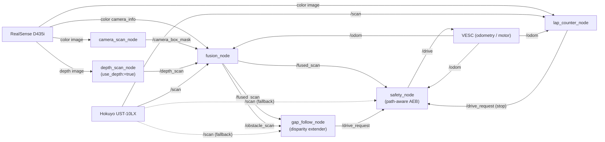
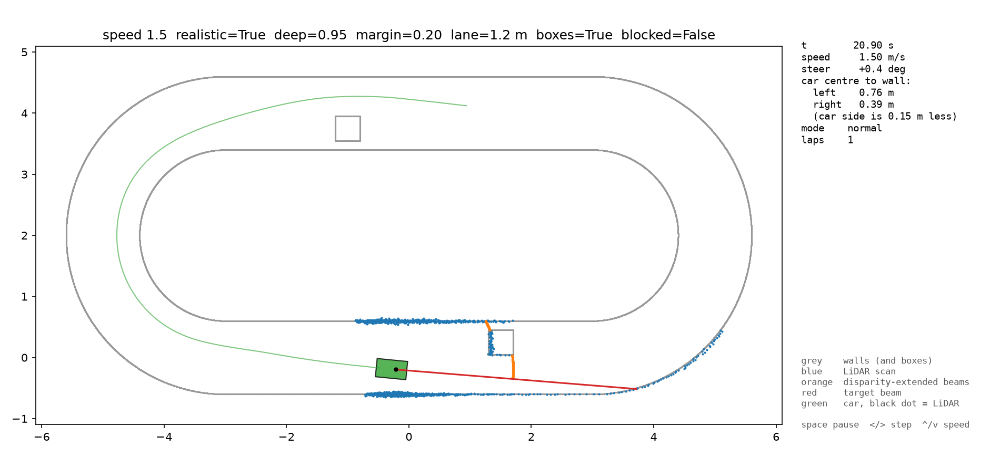
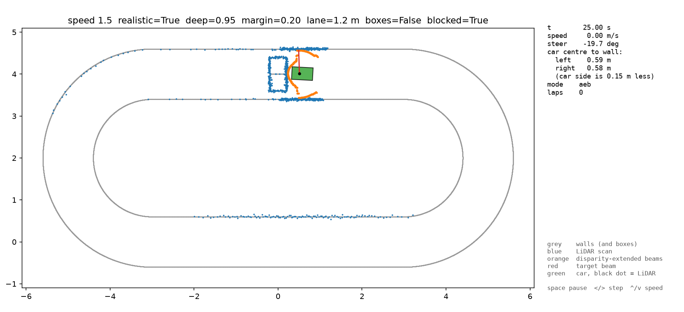

# CPEN 391 Milestone 4 - B4: Improved Driving and Safety


## Project Overview 

This project improves on our Milestone 2 and 3 implementations by fusing LiDAR and camera data to autonomously navigate the track at up to 1.5 m/s (the default top speed), avoid static and moving obstacles, and automatically stop after a set number of laps.

- The **LiDAR is the primary sensor**: handles path planning and triggers emergency braking. 

- The **camera adds what the LiDAR cannot know**: identifies boxes as obstacles, detect objects below the LiDAR's scan plane, and adds a visual reference for lap counting.


## Milestone 4 Improvements

| | Milestones 2 / 3 | Milestone 4 |
|---|---|---|
| Driving | MS2: max-gap on LiDAR. MS3: lane following on a camera scan (0.75 m blind zone, ~70° view) | Disparity extender on the 270° LiDAR scan |
| Speed | Fixed 0.7 m/s | Variable, up to `max_speed` (1.5 m/s by default) |
| AEB | Fixed 0.65 s TTC on every beam; MS3 used the depth camera, which can't see the black walls | LiDAR, path-aware, speed-dependent TTC plus a soft slow-down stage |
| Static obstacles | Bubble around nearest point / passing on straights only | Extended disparities everywhere; wider margin and slower pass at confirmed boxes |
| Dynamic obstacles | Accounts for car's speed only | Optional obstacle-speed tracking |
| Fusion | Camera *or* LiDAR | LiDAR returns projected into the camera image to label boxes; depth adds low objects |
| Lap count | Camera only | Camera + LiDAR + odometry gate |


## Quick Start

Run each command in its own terminal on the car:

1. Car stack (LiDAR, VESC, odometry)

```
source ~/f1tenth_ws/install/setup.bash && ros2 launch f1tenth_stack bringup_launch.py
```

2. Camera

```
source ~/f1tenth_ws/install/setup.bash && ros2 launch realsense2_camera rs_launch.py
```

3. Build and run Milestone 4

```
cd ~/f1tenth_ws && colcon build --packages-select milestone4 && source install/setup.bash \
  && ros2 launch milestone4 milestone4_py.py num_laps:=3 min_lap_distance:=15.0
```

- Ctrl+C in terminal 3 stops the car: `safety_node` sends zero speed before it exits.
- Watch the safety state with `ros2 topic echo /safety/state`.
- Simulator (LiDAR only): `ros2 launch milestone4 milestone4_py.py use_camera:=false odom_topic:=/ego_racecar/odom`.

## System Diagram



`safety_node` is the only node that publishes `/drive`. The planner and the lap counter only send requests, so safety can always override them.

| Node | Role |
|---|---|
| `camera_scan_node` | Splits each colour frame into wall (black ducting) and box (cardboard) masks. Publishes the box mask as `/camera_box_mask` for fusion. While someone views them (rviz), it also projects the masks onto the floor as the LaserScans `/camera_scan` and `/camera_box_scan`. |
| `depth_scan_node` | Turns the depth image into a scan, dropping floor pixels by their height. Off by default. |
| `fusion_node` | Projects every LiDAR return into the box mask to label boxes, and adds depth-only objects (rules below). Publishes `/fused_scan` (same geometry as `/scan`) and `/obstacle_scan` (confirmed boxes). |
| `gap_follow_node` | Disparity extender with pure pursuit and a variable speed. Sends `/drive_request`. |
| `safety_node` | Path-aware AEB with a variable TTC, a soft speed cap, a watchdog and latched stops. Publishes `/drive`. |
| `lap_counter_node` | Counts laps from camera + LiDAR similarity to the start, gated by odometry distance; requests a latched stop after `num_laps`. |

Helper modules (no ROS code): `braking.py` (shared braking model), `fusion.py`, `camera_model.py`, `masks.py`, `boundary.py`, `depth.py`. `node_utils.py` holds the few ROS helpers every node shares (clock arithmetic, header stamps and the entry point).

## Algorithms

### Fusion: LiDAR for geometry, camera for labels

**Box labels: the LiDAR gives the range, the camera gives the class.** Every LiDAR return is projected to its pixel in the camera's box mask, using the camera intrinsics, its mounting (`cam_x`, `cam_yaw_deg`, `cam_z`, `pitch_deg`) and the distance the car drove since the frame was taken. A short strip of rows around that pixel is checked (±`label_strip_deg`); if at least `label_fraction` of it is cardboard, the beam is a confirmed box.

The first version matched ranges instead: the camera's floor distance to a box had to be within 0.25 m of the LiDAR's. From a camera 0.187 m above the floor, one degree of pitch (braking, a bump) moves a box at 2 m by about 0.4 m, so the labels dropped out exactly when the car slowed for a box. A pixel hardly moves with pitch, so the projected labels hold up to about 3° of pitch error and do not need `cam_z` to be exact: with the default, they hold for a camera anywhere from 15 to 22 cm above the floor (`test_a_degree_of_pitch_does_not_lose_the_label`, `test_camera_anywhere_from_15_to_22_cm_above_the_floor`).

| Camera sees | LiDAR at that bearing | Result |
|---|---|---|
| Cardboard at the pixels where a LiDAR return lands | sees it (within `label_max_range`) | **Confirmed box**: LiDAR range kept, beam marked in `/obstacle_scan` |
| Depth object nearer than the LiDAR, for 3 frames in a row | misses it (below the scan plane) | **Added** to `/fused_scan` |
| Cardboard colour on the floor (tape, a flat sheet) | looks over it | Ignored: no LiDAR return lands on those pixels |
| Tan furniture behind the track | sees the black ducting in front | Ignored: the LiDAR return's pixels are ducting |
| Anything farther than the LiDAR | sees something nearer | Ignored |
| Camera older than 0.2 s | – | `/fused_scan` is the plain LiDAR scan |

The camera never moves a LiDAR range; it only labels points or adds persistent objects the LiDAR cannot see.

### Driving: disparity extender with variable speed

- **Disparity extender** (gap-following lecture, tweaks 2–4): at every range jump > 0.3 m, the nearer range is extended over enough beams to cover half the car plus `margin` (0.20 m; 0.25 m at confirmed boxes). The width is kept from the whole near obstacle, not only its edge: a box seen from the side shows two faces as one surface, and its near corner needs more beams than the far end of the side face. The car then aims for the centre of the deepest remaining run of beams.
- **Pure pursuit** steering from the rear axle (the LiDAR sits `lidar_x` = 0.27 m ahead of it), with a lookahead that grows with the measured speed, smoothed and clamped to ±0.4 rad. Treating the LiDAR as the rear axle turned every corner too sharply and made the car ride the inner wall.
- **Variable speed**: the lowest of
  - `max_speed`;
  - a braking limit that keeps the TTC to the planned arc at 2.5 × the time needed to stop; when something is within 0.4 m beside the turning side (the turn is cancelled at `side_clear` = 0.25 m), the straight path counts too;
  - a cornering limit √(a_lat / curvature);
  - `pass_speed` while passing a confirmed box.

  Speed-ups are ramped at 2 m/s².

### Safety: path-aware AEB with a variable TTC

Only scan points inside the car's swept path (the steering arc, ±0.20 m) count, measured along the arc, so side walls in corners no longer trigger AEB.

```
ttc      = (distance along path − stop_margin) / v
T(v)     = t_react + v / (2 · a_brake) + ttc_margin          (time needed to stop)
AEB      ttc ≤ T(v) at the measured speed; brakes until the TTC is back above T(v)
soft cap speed limited so that ttc ≥ 2 · T(v)
```

| Speed | AEB below | AEB distance |
|---|---|---|
| 0.5 m/s | 0.38 s | 0.44 m |
| 1.0 m/s | 0.50 s | 0.75 m |
| 1.5 m/s | 0.62 s | 1.19 m |

- The threshold grows with speed, so faster laps brake earlier.
- The soft cap and the planner's tighter braking limit mean AEB is a last resort.
- With `track_obstacles:=true`, an obstacle's own approach speed is added: scans are lined up using the car's own motion, so only real movement remains. It is off by default until it is validated on the car. In the simulator, a box pushed at the car at the default 1.5 m/s comes within 0.15 m of it without tracking (the car stops, the box keeps coming); with tracking it stays 0.22 m away.

Other safety behaviour:

- **Latched stop**: only the lap counter's stop holds until restart. AEB is not latched: the car drives on once the path opens up.
- **Watchdog**: the car brakes while drive requests or scans are stale.
- **Fallback**: if the fused scan stops, safety and driving fall back to the raw `/scan`.
- **Errors**: an exception in a callback brakes the car instead of killing the node.

### Lap counting

The lap counter compares the current view with the start:

- **Camera**: a blurred Lab thumbnail.
- **LiDAR**: a range profile, matched over ±10° of heading.
- The two similarities are averaged.

A lap counts at the peak of the score, only after the car has left the start and has driven `min_lap_distance` (set to about ¾ of a lap) since the last lap. "Left the start" means the score dropped below `rearm_threshold`, or the car drove `rearm_distance_fraction` of that distance: between solid walls the LiDAR score never drops that far, and with the score alone no lap was ever counted.


## Testing

- **Unit and closed-loop tests** (`milestone4/test/`, 150 tests): the nodes' callbacks are called directly, with `test/ros_stubs.py` standing in for rclpy and the message types, so no ROS install is needed.
  ```bash
  cd milestone4/test
  python3 -m unittest test_braking test_fusion test_gap_follow test_safety test_lap_counter test_perception test_closed_loop test_params test_launch
  ```

  On the car or VM, `colcon test --packages-select milestone4 && colcon test-result --verbose` runs these plus the style checks.
  - Unit tests: the braking model, fusion rules, disparity extender, AEB cases and lap counting.
  - Parameter file (`test_params.py`): every value in `config/milestone4.yaml` is a parameter its node declares, with the right type, so a typo cannot be silently ignored.
  - Launch file (`test_launch.py`): command-line arguments reach the right nodes, whichever section of the file the value sits in.
  - Closed-loop simulation (`test/closed_loop.py`, also runnable on its own): all nodes together on a ray-cast track, covering:
    - 3-lap runs at the default 1.5 m/s;
    - boxes, up to a 2 m/s cap;
    - a box pushed at the car;
    - the lane blocked halfway round by two boxes side by side (gaps narrower than the car): the car stops in front of them and stays stopped;
    - LiDAR dropouts and scan lag;
    - a realistic car (steering delay and error, odometry and range noise) on 1.0–1.2 m tracks without false AEB.
- **Simulator viewer** (`test/sim_viewer.py`): animates a closed-loop run so we can watch what the planner decided on every scan. Needs only `pip install matplotlib numpy`, no ROS.
  ```bash
  cd milestone4/test
  python sim_viewer.py --boxes --realistic --speed 1.5
  python sim_viewer.py --blocked --realistic --speed 1.5
  ```

  Each frame shows:
  - the LiDAR scan (blue);
  - the beams the disparity extender shortened (orange);
  - the target beam (red);
  - the car and its path (green);
  - a panel with speed, steering, the gap to each wall and the safety mode.

  The tests only report pass or fail; the viewer shows *why* the car did something. With it we could:
  - see where the car cut a corner or ran close to a wall, and tune `deep_fraction` and `margin` from the command line (`--deep`, `--margin`) before changing the code;
  - check that boxes are passed with room to spare at 1.5 m/s with the realistic car model (steering lag and error, LiDAR offset, noise);
  - confirm that a blocked lane brings the car to a stop instead of squeezing through.

  This let us find and fix driving problems before spending time on the track.

  **Passing boxes at 1.5 m/s (realistic car):**

  

  **Blocked lane: the car stops in front of the boxes:**

  
- **Style**: flake8, pep257 and copyright checks, run by `colcon test`.
### On-car testing

On early track runs, the car cut an inside corner far enough to trigger AEB, and the steering twitched with smoothing set to `0.3`. We moved the pure-pursuit reference to the rear axle and increased smoothing to `0.6`. We also saw LiDAR scans arrive up to 0.4 s late when the camera started on the Jetson. We reproduced that delay in a simulator test to check how the safety node handled it.

In early runs, the car hugged the left wall. We added LiDAR-based lane centring (centre_gain = 2.0). In the 50 cm-wide strip ahead, returns within 10 cm of a fitted side wall are treated as wall returns, so the centring correction stays active near the wall.

| Track test | Run settings | Observed result |
|---|---|---|
| Three laps on a clear track | `[speed cap]` m/s, camera `[on/off]` | The car completed 3 full laps, and stopped immediately after finishing the third lap (about 2-5cm after). |
| Static box pass | `[speed cap]` m/s, box on `[straight/corner]` | The car passed the obstsacle(s) without making contact while lowering speed. |
| Box blocking the lane | `[speed cap]` m/s | AEB properly engaged. The car stopped within 10cm behind the start line after the alloted laps. |
| Box moving toward the car | `[speed cap]` m/s, obstacle tracking `[on/off]` | The car slowed down and steered around the boxes while continueing around the track. No contact was measured in final testing |
| LiDAR-only run | `[speed cap]` m/s, `use_camera:=false` | The car completed 5 laps using only LiDAR. |

## Tuning on the Track

Try a value with a launch argument (`a_brake:=2.4`), then write it into `config/milestone4.yaml` and rebuild so it sticks.

1. **Camera alignment**: overlay `/scan` and `/camera_scan` in rviz; adjust `cam_x` / `cam_yaw_deg` until the walls line up. Measure `cam_z` (camera lens above the LiDAR's scan plane) with a ruler. Then put a box 1–3 m ahead and check that `/obstacle_scan` marks its whole face and nothing else.
2. **Braking**: let AEB stop the car from a known speed v, measure the stopping distance d, and set `a_brake = v² / (2d)`.
3. **Speed**: the default `max_speed` is 1.5. On a new track, start lower (`max_speed:=1.0`, then 1.25, then 1.5), watching `/safety/state` for unwanted `slow` or `aeb`; then tune `a_lat`.
4. **Lap distance**: read the lap length from the `Lap 1/3 (... m driven)` log and set `min_lap_distance` to about ¾ of it.

## Parameters and Launch Arguments

Every parameter of every node is in `milestone4/config/milestone4.yaml`, the single place to tune the car. Values shared by several nodes (top speed, car geometry, the braking model, timeouts, camera mounting) sit once in its `/**` section, so the planner and the safety node can never use different speeds or braking models. Keep the decimal point on decimal values (`1.0`, not `1`): ROS parameters are typed.

Launch arguments override the file for one run, e.g. `max_speed:=1.25`. Tuning arguments not given on the command line leave the file's value. Use `params_file:=/path/to/copy.yaml` to launch with a different file.

| Argument | File value | Description |
|---|---|---|
| `max_speed` | 1.5 | Top speed, also the safety node's cap (m/s) |
| `pass_speed` | 1.2 | Speed while passing a confirmed box (m/s) |
| `lookahead` / `gain` / `smoothing` | 2.0 / 1.0 / 0.6 | Pure pursuit distance (m), gain, steering smoothing |
| `a_lat` | 2.5 | Cornering grip (m/s²) |
| `margin` | 0.20 | Clearance beyond half the car at edges (m) |
| `lidar_x` | 0.27 | LiDAR distance ahead of the rear axle; pure pursuit steers from the rear axle (0 = old behaviour, turns too sharply and rides inner walls) |
| `deep_fraction` | 0.95 | Beams this close to the deepest count as the gap; lower aims further from inner walls but can aim at a near obstacle |
| `a_brake` / `ttc_margin` / `stop_margin` | 2.0 / 0.1 / 0.25 | Braking model (m/s², s, m) |
| `track_obstacles` | false | Use obstacle speeds in AEB |
| `num_laps` / `min_lap_distance` | 3 / 15.0 | Laps before stopping; shortest lap (m) |
| `similarity_threshold` / `rearm_threshold` | 0.8 / 0.5 | Lap counter thresholds |
| `use_camera` / `use_depth` / `start_camera` | true / false / false | Camera fusion, depth fusion, start the RealSense driver (launch defaults: they choose which nodes start) |
| `odom_topic` | /odom | `/ego_racecar/odom` in the simulator (launch default) |
| `params_file` | `config/milestone4.yaml` | Parameter file for all nodes |
| `cam_x` / `cam_yaw_deg` / `cam_z` | 0.0 / 0.0 / 0.06 | Camera offset from the LiDAR: ahead (m), heading (degrees), height above the scan plane (m) |

## Dependencies

| Dependency | Install |
|---|---|
| ROS 2 (rclpy, sensor_msgs, nav_msgs, std_msgs, launch, launch_ros) | Comes with ROS 2 |
| ackermann_msgs, cv_bridge | `rosdep install --from-paths src/MS4_B4/milestone4 --ignore-src -y` |
| NumPy, OpenCV | `sudo apt install python3-numpy python3-opencv` |
| realsense2_camera | Preinstalled on the cars |
