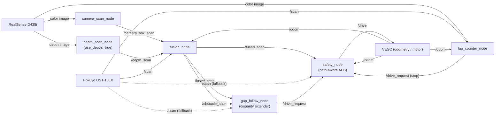

# CPEN 391 Milestone 4 (Group B4): LiDAR and Camera Fusion

The car laps the track at 1.0–1.5 m/s, avoids static and moving obstacles, and stops itself after a set number of laps. The **LiDAR is the primary sensor**: it drives the car and triggers emergency braking. The **camera adds what the LiDAR cannot know**: which obstacles are boxes, objects below the LiDAR's scan plane, and a second signature for lap counting.

## Quick Start

Run each command in its own terminal on the car:

```bash
# 1. car stack (LiDAR, VESC, odometry)
source ~/f1tenth_ws/install/setup.bash && ros2 launch f1tenth_stack bringup_launch.py

# 2. camera
source ~/f1tenth_ws/install/setup.bash && ros2 launch realsense2_camera rs_launch.py

# 3. build and run Milestone 4
cd ~/f1tenth_ws && colcon build --packages-select milestone4 && source install/setup.bash \
  && ros2 launch milestone4 milestone4_py.py num_laps:=3 min_lap_distance:=15.0
```

- Hold the joystick's autonomous button, or `/drive` does not reach the motor.
- Ctrl+C in terminal 3 stops the car: `safety_node` sends zero speed before it exits.
- Watch the safety state with `ros2 topic echo /safety/state`.
- Simulator (LiDAR only): `ros2 launch milestone4 milestone4_py.py use_camera:=false odom_topic:=/ego_racecar/odom`.

## System Diagram



`safety_node` is the only node that publishes `/drive`. The planner and the lap counter only send requests, so safety can always override them.

| Node | Role |
|---|---|
| `camera_scan_node` | Splits each colour frame into wall (black ducting) and box (cardboard) masks and projects them onto the floor as LaserScans. A box must stand on the floor, so tan furniture behind the barriers is not one. |
| `depth_scan_node` | Turns the depth image into a scan, dropping floor pixels by their height. Off by default. |
| `fusion_node` | Combines the camera scans with each LiDAR scan (rules below). Publishes `/fused_scan` (same geometry as `/scan`) and `/obstacle_scan` (confirmed boxes). |
| `gap_follow_node` | Disparity extender with pure pursuit and a variable speed. Sends `/drive_request`. |
| `safety_node` | Path-aware AEB with a variable TTC, a soft speed cap, a watchdog and latched stops. Publishes `/drive`. |
| `lap_counter_node` | Counts laps from camera + LiDAR similarity to the start, gated by odometry distance; requests a latched stop after `num_laps`. |

Helper modules (no ROS code): `braking.py` (shared braking model), `fusion.py`, `camera_model.py`, `masks.py`, `boundary.py`, `depth.py`, `debug_draw.py`.

## Algorithms

### Fusion: LiDAR for geometry, camera for labels

Camera points are moved into the LiDAR frame (`cam_x`, `cam_yaw_deg`, plus the distance the car drove since the frame was taken) and matched to LiDAR beams.

| Camera sees | LiDAR at that bearing | Result |
|---|---|---|
| Box colour, within 0.25 m of a LiDAR return | sees it | **Confirmed box**: LiDAR range kept, beam marked in `/obstacle_scan` |
| Depth object nearer than the LiDAR, for 3 frames in a row | misses it (below the scan plane) | **Added** to `/fused_scan` |
| Box colour nearer than the LiDAR | misses it | Ignored: colour can't measure height (could be a floor marking) |
| Anything farther than the LiDAR | sees something nearer | Ignored |
| Camera older than 0.2 s | – | `/fused_scan` is the plain LiDAR scan |

The camera never moves a LiDAR range; it only labels points or adds persistent objects the LiDAR cannot see.

### Driving: disparity extender with variable speed

- **Disparity extender** (gap-following lecture, tweaks 2–4): at every range jump > 0.3 m, the nearer range is extended over enough beams to cover half the car plus `margin` (0.20 m; 0.25 m at confirmed boxes). The car then aims for the centre of the deepest remaining run of beams.
- **Pure pursuit** steering from the rear axle (the LiDAR sits `lidar_x` = 0.27 m ahead of it), with a lookahead that grows with the measured speed, smoothed and clamped to ±0.4 rad. Treating the LiDAR as the rear axle turned every corner too sharply and made the car ride the inner wall.
- **Variable speed**: the lowest of
  - `max_speed`;
  - a braking limit that keeps the TTC to the planned arc at 2.5 × the time needed to stop;
  - a cornering limit √(a_lat / curvature);
  - `pass_speed` while passing a confirmed box.

  Speed-ups are ramped at 2 m/s².

### Safety: path-aware AEB with a variable TTC

Only scan points inside the car's swept path (the steering arc, ±0.20 m) count, measured along the arc, so side walls in corners no longer trigger AEB.

```
ttc      = (distance along path − stop_margin) / v
T(v)     = t_react + v / (2 · a_brake) + ttc_margin          (time needed to stop)
AEB      ttc ≤ T(v), at the measured speed — latched until restart
soft cap speed limited so that ttc ≥ 2 · T(v)
```

| Speed | AEB below | AEB distance |
|---|---|---|
| 0.5 m/s | 0.38 s | 0.44 m |
| 1.0 m/s | 0.50 s | 0.75 m |
| 1.5 m/s | 0.62 s | 1.19 m |

- The threshold grows with speed, so faster laps brake earlier.
- The soft cap and the planner's tighter braking limit mean AEB is a last resort.
- With `track_obstacles:=true`, an obstacle's own approach speed is added: scans are lined up using the car's own motion, so only real movement remains. It is off by default until it is validated on the car.

Other safety behaviour:
- **Latched stops**: AEB, the lap counter's stop, and a path blocked for 1 s all stop the car until restart.
- **Watchdog**: the car brakes while drive requests or scans are stale.
- **Fallback**: if the fused scan stops, safety and driving fall back to the raw `/scan`.
- **Errors**: an exception in a callback brakes the car instead of killing the node.

### Lap counting

The lap counter compares the current view with the start:
- **Camera**: a blurred L\*a\*b\* thumbnail.
- **LiDAR**: a range profile, matched over ±10° of heading.
- The two similarities are averaged.

A lap counts at the peak of the score, only after the score has dropped in a corner and the car has driven `min_lap_distance` (set to about ¾ of a lap) since the last lap.

## Improvements over Milestones 2 and 3

| | Milestones 2 / 3 | Milestone 4 |
|---|---|---|
| Driving | MS2: max-gap on LiDAR. MS3: lane following on a camera scan (0.75 m blind zone, ~70° view) | Disparity extender on the 270° LiDAR scan |
| Speed | Fixed 0.7 m/s | Variable, up to `max_speed` (1.0 default, 1.5 tested in simulation) |
| AEB | Fixed 0.65 s TTC on every beam; MS3 used the depth camera, which can't see the black walls | LiDAR, path-aware, speed-dependent TTC plus a soft slow-down stage |
| Static obstacles | Bubble around nearest point / passing on straights only | Extended disparities everywhere; wider margin and slower pass at confirmed boxes |
| Dynamic obstacles | Own speed only | Optional obstacle-speed tracking |
| Fusion | Camera *or* LiDAR | Camera labels LiDAR points; depth adds low objects |
| Lap count | Camera only | Camera + LiDAR + odometry gate |

## Testing

- **Unit and closed-loop tests** (`milestone4/test/`, 134 tests): the nodes' callbacks are called directly, with `test/ros_stubs.py` standing in for rclpy and the message types, so no ROS install is needed.

  ```bash
  cd milestone4/test
  python3 -m unittest test_braking test_fusion test_gap_follow test_safety test_lap_counter test_perception test_closed_loop test_params
  ```

  On the car or VM, `colcon test --packages-select milestone4 && colcon test-result --verbose` runs these plus the style checks.

  - Unit tests: the braking model, fusion rules, disparity extender, AEB cases and lap counting.
  - Parameter file (`test_params.py`): every value in `config/milestone4.yaml` is a parameter its node declares, with the right type, so a typo cannot be silently ignored.
  - Closed-loop simulation (`test/closed_loop.py`, also runnable on its own): all nodes together on a ray-cast track, covering:
    - 3-lap runs at 1.0 and 1.5 m/s;
    - boxes;
    - a box pushed at the car;
    - the lane blocked halfway round by two boxes side by side (gaps narrower than the car): the car stops in front of them and stays stopped;
    - LiDAR dropouts and scan lag;
    - a realistic car (steering delay and error, odometry and range noise) on 1.0–1.2 m tracks without false AEB.
- **Style**: flake8, pep257 and copyright checks, run by `colcon test`.
- **On the car**:
  1. Empty laps, then static boxes, raising `max_speed` in steps.
  2. A box on a straight and in a corner, to check AEB stops in time without firing falsely in corners.
  3. A box pushed at the car.
  4. `use_camera:=false`, to check LiDAR-only driving.
  5. 3-lap counting.

## Tuning on the Track

Try a value with a launch argument (`a_brake:=2.4`), then write it into `config/milestone4.yaml` and rebuild so it sticks.

1. **Camera alignment**: overlay `/scan` and `/camera_scan` in rviz; adjust `cam_x` / `cam_yaw_deg` until the walls line up.
2. **Braking**: let AEB stop the car from a known speed v, measure the stopping distance d, and set `a_brake = v² / (2d)`.
3. **Speed**: raise `max_speed` 1.0 → 1.25 → 1.5, watching `/safety/state` for unwanted `slow` or `aeb`; then tune `a_lat`.
4. **Lap distance**: read the lap length from the `Lap 1 (... m driven)` log and set `min_lap_distance` to about ¾ of it.

## Parameters and Launch Arguments

Every parameter of every node is in **`milestone4/config/milestone4.yaml`**, the single place to tune the car. Values shared by several nodes (car geometry, the braking model, timeouts, camera mounting) sit once in its `/**` section, so the planner and the safety node can never use different braking models. Keep the decimal point on decimal values (`1.0`, not `1`): ROS parameters are typed.

Launch arguments override the file for one run, e.g. `max_speed:=1.25`. Tuning arguments not given on the command line leave the file's value. Use `params_file:=/path/to/copy.yaml` to launch with a different file.

| Argument | File value | Description |
|---|---|---|
| `max_speed` | 1.0 | Top speed, also the safety node's cap (m/s) |
| `pass_speed` | 0.55 | Speed while passing a confirmed box (m/s) |
| `lookahead` / `gain` / `smoothing` | 2.0 / 1.0 / 0.6 | Pure pursuit distance (m), gain, steering smoothing |
| `a_lat` | 2.5 | Cornering grip (m/s²) |
| `margin` | 0.20 | Clearance beyond half the car at edges (m) |
| `lidar_x` | 0.27 | LiDAR distance ahead of the rear axle; pure pursuit steers from the rear axle (0 = old behaviour, turns too sharply and rides inner walls) |
| `deep_fraction` | 0.95 | Beams this close to the deepest count as the gap; lower aims further from inner walls but can aim at a near obstacle |
| `a_brake` / `ttc_margin` / `stop_margin` | 2.0 / 0.1 / 0.25 | Braking model (m/s², s, m) |
| `track_obstacles` | false | Use obstacle speeds in AEB |
| `num_laps` / `min_lap_distance` | 3 / 15.0 | Laps before stopping; shortest lap (m) |
| `similarity_threshold` / `rearm_threshold` | 0.8 / 0.5 | Lap counter thresholds |
| `use_camera` / `use_depth` / `start_camera` | true / false / false | Camera fusion, depth fusion, start the RealSense driver (launch defaults: they choose which nodes start) |
| `odom_topic` | /odom | `/ego_racecar/odom` in the simulator (launch default) |
| `params_file` | `config/milestone4.yaml` | Parameter file for all nodes |
| `cam_x` / `cam_yaw_deg` | 0.0 / 0.0 | Camera offset from the LiDAR (m, degrees) |

## Dependencies

| Dependency | Install |
|---|---|
| ROS 2 (rclpy, sensor_msgs, nav_msgs, std_msgs, launch, launch_ros) | Comes with ROS 2 |
| ackermann_msgs, cv_bridge | `rosdep install --from-paths src/MS4_B4/milestone4 --ignore-src -y` |
| NumPy, OpenCV | `sudo apt install python3-numpy python3-opencv` |
| realsense2_camera | Preinstalled on the cars |
